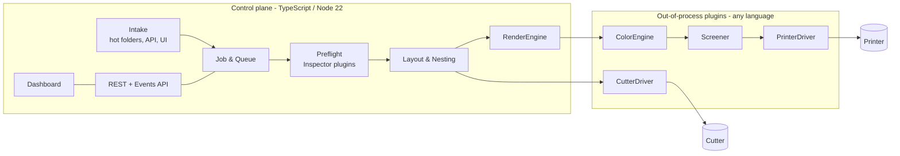

# BAX Print Suite

**An open-source, modular RIP and print production platform for wide-format shops.**

[](LICENSE)

[](CONTRIBUTING.md#developer-certificate-of-origin)

BAX Print Suite aims to be a professional, full-featured alternative to commercial RIP and print workflow software: job intake and queueing, hot folders, preflight, nesting, PDF rendering, ICC color management, screening, printer output, and contour-cut export. It's built as a plugin platform, so new printers, cutters, and RIP engines can be added without touching the core.

> **Status: pre-alpha.** Nothing here is production-ready yet. Interfaces may change until v1.0, following the versioning rules in [ARCHITECTURE.md](docs/ARCHITECTURE.md#plugin-versioning-and-compatibility).

## Vision
- **Professional, not basic.** PDF/X-4 transparency and overprint, spot colors and DeviceN, N-channel output (CMYK, light inks, white, varnish), and streaming raster for very wide output.
- **Modular by design.** Render engines, color engines, screeners, printer drivers, cutter drivers, inspectors, and storage are all plugins behind stable, versioned interfaces.
- **License-clean.** The core is Apache-2.0. Copyleft engines and proprietary vendor SDKs run only as separate, optional, out-of-process plugins.
- **Built on open standards.** PDF (ISO 32000), PDF/X (ISO 15930), ICC.1, CIP4 JDF/XJDF concepts, OpenAPI.

## Architecture



See [docs/ARCHITECTURE.md](docs/ARCHITECTURE.md) for the full design and [docs/adr/](docs/adr/) for the decisions behind it.

## Roadmap
| Milestone | Scope |
|---|---|
| M1 | Intake, job model, queue, hot folders, plugin SDK, mock printer driver |
| M2 | Dashboard, plus handoff to an existing RIP's hot folder |
| M3 | Nesting |
| M4 | Cut export (HPGL, DXF) |
| M5 | Ghostscript render plugin plus preview |
| M6 | Color pipeline (LittleCMS) |
| M7 | Screening |
| M8 | First native printer driver (via the vendor's developer program) |

Details and the parallel tracks are in [docs/ROADMAP.md](docs/ROADMAP.md).

## Quickstart
_Coming with M1._ It'll look like this:
```bash
pnpm install
pnpm build
pnpm --filter @bax-print/server start
```

## Contributing
Contributions are welcome. Read [CONTRIBUTING.md](CONTRIBUTING.md) first. All commits need a DCO sign-off (`git commit -s`), and contributions must follow our clean-room rule.

- [Code of Conduct](CODE_OF_CONDUCT.md) · [Security policy](SECURITY.md) · [Governance](GOVERNANCE.md) · [Licensing policy](docs/LICENSING.md)

## License
Apache License 2.0. See [LICENSE](LICENSE) and [NOTICE](NOTICE).

BAX Print Suite is an independent project maintained by BAX Forward. It is **not affiliated with, endorsed by, or derived from any commercial RIP, printer, or cutter vendor.** Product names are trademarks of their respective owners and are used only to describe compatibility.
