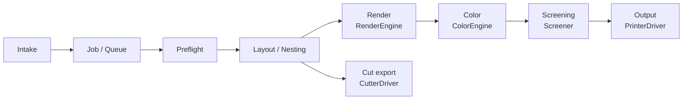

# BAX Print Suite Architecture

Status: Draft v0.1 (pre-alpha). Changes to anything marked **Stable contract** require an ADR.

## 1. Goals and non-goals
**Goals:** a production-grade RIP and print workflow platform; modular printers, cutters, and engines; license-clean (Apache-2.0 core); runs on a single Windows PC first, then scales to a server plus workers without a redesign; **hardware-agnostic**: no printer or cutter vendor, model, or command language in core packages. Devices are described by capability profiles (§3.8), and vendor specifics live only in driver plugins.
**Non-goals (core):** bundling copyleft engines or proprietary SDKs; reimplementing PDF interpretation in the core.

## 2. Layered pipeline



| Stage | Responsibility | Extension point |
|---|---|---|
| Intake | Hot folders, API upload, UI upload, (later) JMF/XJDF intake. Stable-write detection, hashing, managed storage | Storage |
| Job / Queue | Job state machine, priorities, holds, routing rules, retries | (core) |
| Preflight | Page count and boxes, fonts, colorants, transparency/overprint, output intent, fixups | Inspector |
| Layout / Nesting | Tiling, step-and-repeat, true-shape nesting, marks, cut-path extraction | (core library; nest algorithms pluggable later) |
| Render | PDF to contone planar bands in a working or device colorant space | RenderEngine |
| Color | ICC transforms, N-color / DeviceN mapping, ink limits, linearization, white/varnish generation | ColorEngine |
| Screening | Contone to device dot levels (error diffusion, threshold arrays, multi-level) | Screener |
| Output | Device encoding and transport, status, media, accounting | PrinterDriver |
| Cut export | Contours plus registration to generic formats (HPGL, DXF, SVG) or plugin-provided device formats, or a live cutter (roll or flatbed) | CutterDriver |

Every stage is a **job step** with recorded inputs and outputs, so steps can be retried, inspected, and moved to workers.

## 3. Plugin model

### 3.1 Process boundary (Stable contract)
Plugins are **separate executables** that talk to the host over a defined IPC protocol. They're never linked into or loaded in the host process. This lets:
- AGPL engines (e.g. Ghostscript) run as independent programs (ADR-0004),
- proprietary vendor SDK plugins ship separately under their own licenses (ADR-0005),
- crashes and memory blowups stay contained,
- plugins be written in any language (TypeScript, Rust, C++, Python).

### 3.2 Protocol: BPS Plugin Protocol (BPP) v1
- **Control channel:** JSON-RPC 2.0 over stdio, with LSP-style `Content-Length` framing. stderr is for logs only (structured JSON lines).
- **Data channel (raster and large blobs):** referenced by handle, never inlined:
  - `file`: a path in a host-owned spool directory (default, portable).
  - `shm`: a named shared-memory ring of band buffers (an optimization, negotiated by capability).
  - Each band message: `{bandId, y0, height, width, planes:[{colorant, bitsPerSample, stride, offset}], handle}`.
- **Lifecycle:** `initialize` (host and plugin versions, capabilities) → `configure` → operation calls → `shutdown`. Health via `$/ping`. Cancellation via `$/cancel`. Progress via `$/progress` notifications.
- **Back-pressure:** the consumer acknowledges bands (`band/release`). The host bounds in-flight bands per job.

### 3.3 Interfaces (each independently versioned)

| Interface | Key methods | Notes |
|---|---|---|
| `RenderEngine/1` | `probe(doc)`, `render(doc, page, {dpi, region?, colorants, outputProfile?, bpc, overprintSim})` → band stream | May do color itself if it advertises `color.inline` |
| `ColorEngine/1` | `createTransform(src, dst, intent, opts)`, `apply(transform, bands)`, `inkLimit`, `linearize` | LittleCMS-based default |
| `Screener/1` | `listMethods()`, `screen(bands, {method, levels, seed})` → band stream | Rust reference plugin planned |
| `PrinterDriver/1` | `discover()`, `getStatus()`, `listMedia()`, `submit(job, bandStream)`, `cancel()`, `accounting()` | Mock driver lives in the public repo |
| `CutterDriver/2` | `describe()` → CutterProfile, `formats()`, `export(cutJob)` → file, optional `send()`, `getStatus()`, `cancel()` | Generic HPGL/DXF in the public repo. Roll and flatbed via one profile model (spec 004) |
| `Inspector/1` | `inspect(doc)` → `PreflightReport`, optional `fixup()` | Built-in pdf-lib inspector |
| `Storage/1` | `put/get/stat/delete/list` blobs; job DB repository | In-process allowed for built-ins (Apache code only) |

Interfaces are defined once in `packages/plugin-sdk` as TypeScript types plus JSON Schema. Rust and other-language bindings are generated from the JSON Schema.

### 3.4 Plugin manifest (`bps-plugin.json`)
```json
{
  "id": "org.bax-print.render.ghostscript",
  "name": "Ghostscript Render Engine",
  "version": "0.1.0",
  "license": "Apache-2.0",
  "provides": [{"interface": "RenderEngine", "versions": ">=1.0 <2"}],
  "protocol": "bpp/1",
  "exec": {"command": "node", "args": ["dist/main.js"], "platforms": ["win32-x64","linux-x64","darwin-arm64"]},
  "externalDependencies": [{"name": "ghostscript", "license": "AGPL-3.0-or-later", "userInstalled": true, "detect": "gswin64c --version"}],
  "permissions": {"fs": ["spool:rw", "input:r"], "network": false, "devices": []},
  "capabilities": {"maxColorants": 64, "bpc": [8,16], "overprintSimulation": true}
}
```
The manifest declares the plugin's own license and any **external** dependencies, which the UI shows to users before enabling it.

### 3.5 Capability discovery
Static capabilities come from the manifest. Dynamic ones come from `initialize` (e.g. a detected engine version, attached devices). The router picks plugins by required capabilities (e.g. `colorants ≥ 7`, `white`, `bpc 16`).

### 3.6 Versioning and compatibility
- Protocol (`bpp/N`) and each interface (`RenderEngine/N`) follow SemVer. Minor versions add optional fields or methods only. Majors may break.
- Host supports the current and previous interface major for at least one release cycle.
- Unknown fields must be ignored. Required new behavior goes behind a negotiated capability.
- A conformance test kit (`@bax-print/plugin-sdk/conformance`) is the definition of compliance.

### 3.7 Trust and sandboxing
- **Trust levels:** `builtin` (shipped here), `verified` (signed by BAX Forward), `third-party` (user-approved). Signature: Sigstore/cosign over the plugin package (planned).
- Plugins run as child processes with a scrubbed environment, a working dir under the spool, and declared fs/network permissions. OS-level sandboxing (Windows Job Objects/AppContainer, Linux namespaces/seccomp) is applied progressively. Permission declarations are enforced where the OS allows and audited elsewhere.
- Secrets (device credentials, vendor keys) are passed only through `configure` from the host's secret store, never written to the manifest or logs.

### 3.8 Device capability profiles (hardware-agnostic rule)
Core code branches only on **declared capabilities**, never on vendor or model names. Printer profiles declare things like accepted input (bands/document), colorants, resolutions, media handling. Cutter profiles declare the machine class (`roll` | `flatbed`), working area, tools, registration methods, and job delivery (spec 004). Adding a manufacturer means adding a plugin and profile. Core needs no change. A CI check rejects vendor names in `packages/*` (`scripts/check-vendor-neutral.ts`, allow-list for docs/research and plugins/).

## 4. Data model
Our own model, informed by CIP4 JDF/XJDF concepts (intent vs. process, resources, audit trail). It is not a JDF schema clone. XJDF/JMF import and export is an adapter.

| Entity | Key fields |
|---|---|
| `Job` | id (ULID), name, customerRef, status, priority, sourceFiles[], ticketId, deviceId?, steps[], createdAt/updatedAt, audit[] |
| `JobTicket` | product intent (size, quantity, finishing, media intent, color intent), process params per stage, overrides |
| `JobStep` | stage, plugin id and version, inputs[], outputs[], status, timings, logs ref |
| `Media` | id, name, vendor, type, width/roll/sheet, thickness, device-specific presets, profile refs |
| `Device` | id, kind (printer/cutter), driver plugin id, capability profile (§3.8), connection (secret ref), capabilities snapshot, status |
| `Profile` | id, kind (ICC output/input/devicelink, linearization, ink-limit), colorants[], hash, **provenance** (source, license, redistributable) |
| `HotFolder` | id, path, enabled, ticket template, filters, routing |

Job status machine (core): `received → inspecting → ready → (held ⇄ queued) → processing → sent_to_device → printed → done`, plus `sent_to_device → done` (output whose print confirmation is not observable, e.g. handoff), `failed` and `cancelled`. Step-level states are separate.

## 5. Event bus
- In-process typed event emitter in single-PC mode. The same envelope goes over NATS or Redis Streams in server mode (adapter).
- Envelope: `{id, type, time, source, subject, data}` (CloudEvents 1.0 compatible).
- Types: `job.created`, `job.status.changed`, `step.started|progress|completed|failed`, `device.status`, `device.accounting`, `hotfolder.file.detected`.
- Events are persisted to an outbox table for replay, webhooks, and the dashboard.

## 6. API
- REST/JSON (Fastify), described by **OpenAPI 3.1** generated from the same schemas the code uses.
- Events: Server-Sent Events at `/events` (WebSocket optional). Outbound webhooks.
- Resources: `/jobs`, `/jobs/{id}/steps`, `/hotfolders`, `/devices`, `/media`, `/profiles`, `/plugins`, `/health`.
- Auth: local-only (loopback) without auth by default in single-PC mode. API tokens or OIDC in server mode. Role-based: viewer, operator, admin.

## 7. Streaming / banded raster
Wide-format pages can be hundreds of GB uncompressed (e.g. 64 in × 50 ft at 1200 dpi × 6 planes ≈ 330 GB at 8 bpc). So:
- Every raster stage consumes and produces **bands** (configurable height, e.g. 256 rows). No stage may require a full page in memory.
- Band buffers come from a bounded pool. Back-pressure propagates from the PrinterDriver upstream.
- Nesting produces an imposed PDF (or a placement list) so the render engine sees one logical page per print.
- Optional spool-to-disk between stages enables reprints without re-RIPing.

## 8. Scale and deployment
1. **Single PC (default):** one Node process (API, queue, scheduler, UI) plus plugin child processes. SQLite (`node:sqlite`) and a local spool. Windows service or a tray app.
2. **Server and workers:** the control plane runs with Postgres and object/blob storage. Workers are stateless and run plugin steps, pulling work from the queue (same step contract). Devices attach to the worker nearest the printer.
3. **Containers:** official images for the control plane and workers. Copyleft engines are installed by the user in derived images (ADR-0004).

The `Storage` and event-bus interfaces are what make this a configuration change rather than a rewrite.

## 9. Security model
- Untrusted inputs: PDFs, images, and cut files are parsed only inside plugin processes (crash and exploit containment), with time and memory limits.
- Hot folders: canonicalize paths, reject symlinks and junctions out of the root, and ignore temp/partial files.
- Secrets: OS keychain or Windows DPAPI in single-PC mode, an external secret store in server mode. Never in the repo or logs.
- Supply chain: lockfile, license and vulnerability checks in CI, SBOM (CycloneDX) per release, signed releases.

## 10. Dashboard
A web app (served by the control plane) that uses only the public REST and SSE API. No private back channel. It shows queue, devices, ink/media accounting (as drivers report it), hot folders, and plugin management. Any third party can build an alternative UI.

## 11. Language flexibility
| Piece | Language |
|---|---|
| Control plane: API, queue, scheduler, hot folders, nesting, dashboard | TypeScript, Node 22 (ADR-0001) |
| Plugin SDK | TypeScript types plus JSON Schema (source of truth); generated Rust bindings |
| Screening, raster transforms, encoders | Rust preferred (behind BPP) |
| Engine wrappers (Ghostscript, etc.) | Any. Thin wrappers around the external program |
| Vendor drivers | Whatever the vendor SDK needs (often C/C++ or .NET), in separate repos |

## 12. Repository layout
```
packages/plugin-sdk    protocol types, JSON Schemas, host/plugin helpers, conformance kit
packages/core          domain model, state machine (pure)
packages/store         Storage/repository interface + sqlite impl
packages/inspect       Inspector interface + pdf-lib impl
packages/hotfolder     intake
packages/events        event bus + outbox
plugins/printer-mock   mock PrinterDriver (reference + tests)
apps/server            Fastify API, scheduler, plugin host
apps/cli               `bps` CLI
apps/dashboard         (M2)
docs/                  architecture, ADRs, licensing, roadmap, research
```
